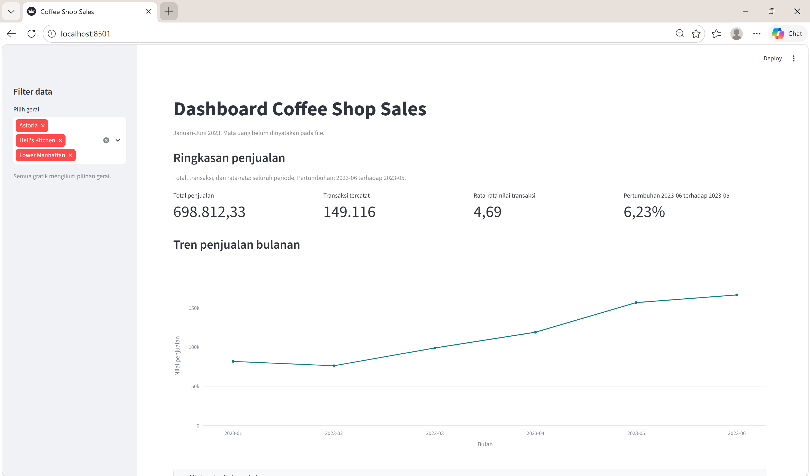
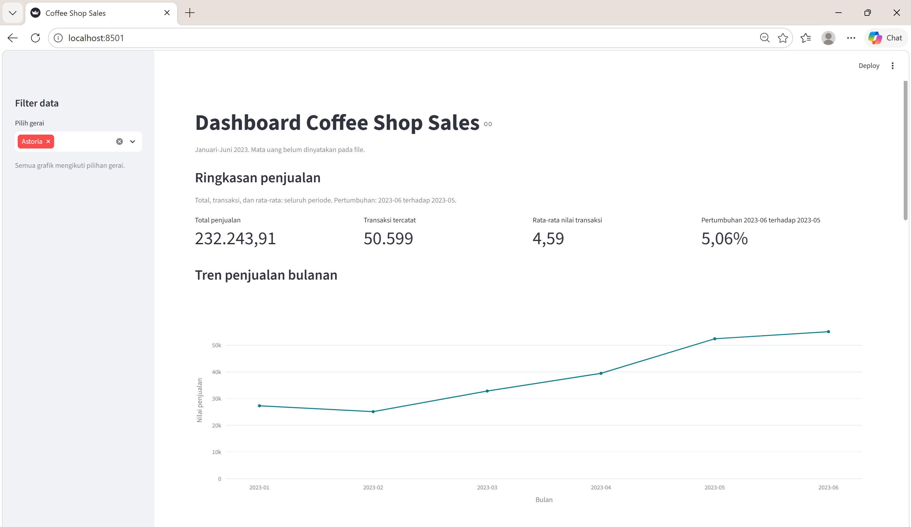

# Praktikum Business Intelligence Pertemuan 5

## Studi Kasus Coffee Shop Sales

Praktikum ini menggunakan dataset **Coffee Shop Sales** periode **Januari–Juni 2023** yang mencakup tiga gerai, yaitu **Astoria**, **Hell's Kitchen**, dan **Lower Manhattan**. Dashboard dibuat menggunakan **Python, Pandas, Streamlit, dan Plotly**.

---

## 1. Hasil Audit Data

Audit data dilakukan menggunakan `audit_prepare_coffee.py`.

Hasil audit:

- Jumlah baris tetap: **149.116**
- Nilai kosong: **0**
- Baris duplikat: **0**
- `product_detail` yang diperbaiki karena spasi: **1.952**
- Produk dengan variasi harga: **15**
- Total unit terjual: **214.470**
- Total nilai penjualan: **698.812,33**
- Status audit: **LULUS AUDIT DASAR**

Perbaikan yang dilakukan hanya berupa penghapusan spasi di awal dan akhir nilai teks pada `product_detail`. Tidak ada transaksi yang dihapus.

Variasi harga tidak otomatis dianggap sebagai kesalahan karena dataset tidak memiliki aturan bisnis yang menyatakan bahwa satu produk harus selalu memiliki harga yang sama. Perbedaan harga perlu diperiksa lebih lanjut berdasarkan produk dan tanggal sebelum dinyatakan sebagai kesalahan.

---

## 2. Empat Angka Kontrol Seluruh Gerai

Dengan filter semua gerai aktif, diperoleh:

| Indikator | Nilai |
|---|---:|
| Total penjualan | **698.812,33** |
| Transaksi tercatat | **149.116** |
| Rata-rata nilai transaksi | **4,69** |
| Pertumbuhan Juni terhadap Mei | **6,23%** |

Screenshot:

---

## 3. Filter Astoria

Setelah filter diubah sehingga hanya gerai **Astoria** yang dipilih, diperoleh:

- Total penjualan: **232.243,91**
- Transaksi tercatat: **50.599**
- Rata-rata nilai transaksi: **4,59**
- Pertumbuhan Juni terhadap Mei: **5,06%**

Hal ini menunjukkan bahwa seluruh indikator dan grafik berubah mengikuti cakupan filter gerai.

Screenshot:

---

## 4. Perbandingan Tiga Gerai

Nilai penjualan Januari–Juni 2023:

| Gerai | Nilai Penjualan | Transaksi Tercatat |
|---|---:|---:|
| Hell's Kitchen | **236.511,17** | **50.735** |
| Astoria | **232.243,91** | **50.599** |
| Lower Manhattan | **230.057,25** | **47.782** |

**Temuan:** Hell's Kitchen memiliki nilai penjualan tertinggi selama periode Januari–Juni 2023, yaitu **236.511,17**.

---

## 5. Kategori dengan Kontribusi Penjualan Terbesar

Dengan filter seluruh gerai, kategori dengan kontribusi terbesar adalah:

- Kategori: **Coffee**
- Nilai penjualan: **269.952,45**
- Kontribusi terhadap total penjualan: **38,63%**

Artinya, kategori Coffee memberikan kontribusi terbesar terhadap total nilai penjualan dalam cakupan seluruh gerai.

---

## 6. Produk dengan Nilai Penjualan Tertinggi

Produk dengan nilai penjualan tertinggi adalah:

- Produk: **Sustainably Grown Organic Lg**
- Product ID: **61**
- Nilai penjualan: **21.151,75**

Peringkat produk pada dashboard menggunakan **total nilai penjualan**, bukan jumlah unit yang terjual dan bukan laba produk.

---

## 7. Jam dengan Transaksi Tercatat Terbesar

Jam dengan transaksi tercatat paling banyak adalah:

- Jam: **10:00**
- Jumlah transaksi tercatat: **18.545**

Jumlah transaksi yang tinggi pada pukul 10:00 belum membuktikan bahwa antrean panjang. Dataset hanya mencatat jumlah transaksi berdasarkan jam dan tidak memiliki informasi mengenai panjang antrean maupun durasi pelayanan.

---

## 8. Insight

Pada periode **Januari–Juni 2023** dengan filter **seluruh gerai**, penjualan Juni meningkat **6,23%** dibandingkan Mei, yaitu dari **156.727,76** menjadi **166.485,88**. Jumlah transaksi tercatat meningkat dari **33.527** menjadi **35.352**, sedangkan rata-rata nilai transaksi tercatat meningkat dari **4,67** menjadi **4,71**.

Dataset menunjukkan perubahan yang terjadi, tetapi belum dapat menjelaskan penyebab kenaikan tersebut karena tidak tersedia informasi mengenai promosi, biaya operasional, antrean, atau identitas pelanggan.

Tindakan pemeriksaan selanjutnya adalah menelusuri kontribusi masing-masing gerai dan kategori produk untuk mengetahui bagian data yang paling berkontribusi terhadap perubahan penjualan Juni.

---

## Definisi Empat Indikator

| Indikator | Definisi |
|---|---|
| Total Penjualan | Jumlah seluruh nilai `sales` pada periode dan gerai terpilih |
| Jumlah Transaksi Tercatat | Jumlah `transaction_id` unik dalam cakupan filter |
| Rata-rata Nilai Transaksi | Total penjualan dibagi jumlah transaksi tercatat |
| Pertumbuhan Bulan Terakhir | Perubahan penjualan bulan terakhir dibanding bulan sebelumnya |